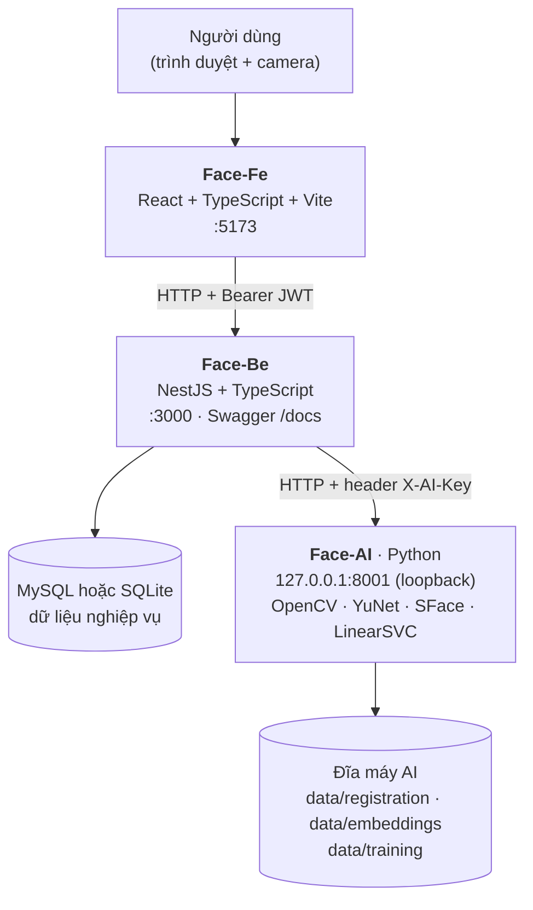
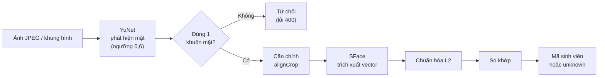
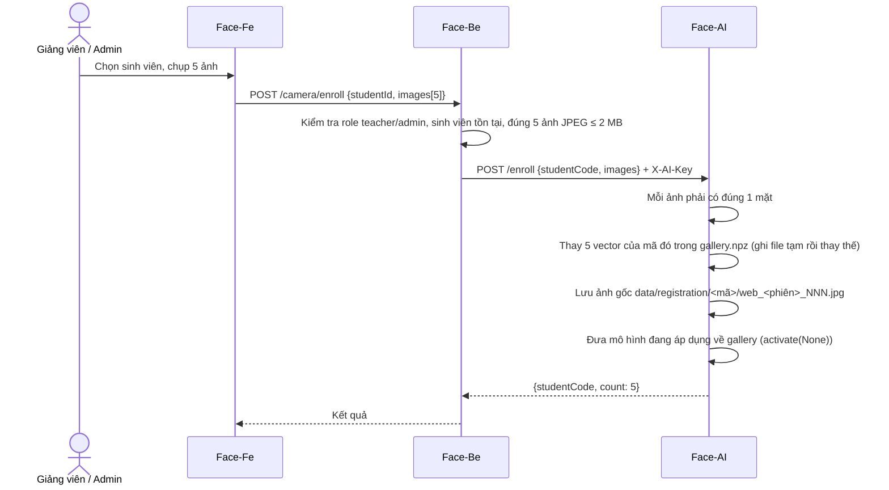
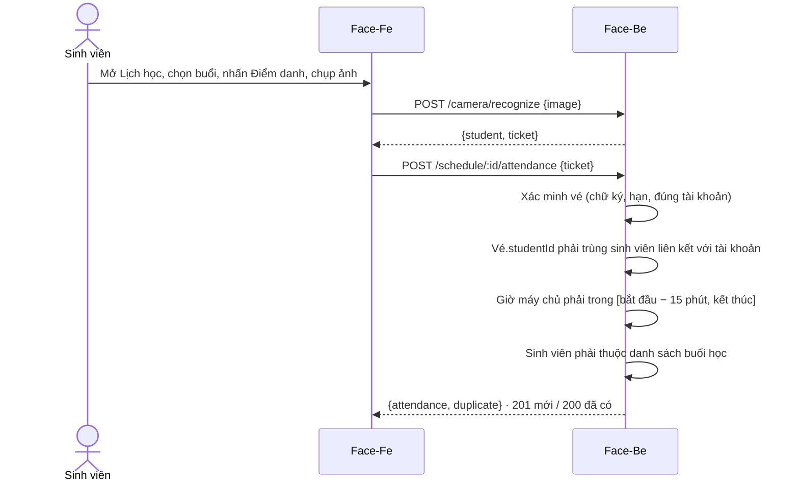
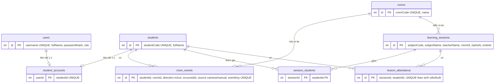

# FaceID-SV — Technical Design Document (TDD)

> **Hệ thống nhận diện khuôn mặt sinh viên: quản lý sinh viên · ghi nhận ra/vào phòng · điểm danh theo lịch học**

| Trường | Giá trị |
|---|---|
| Tên dự án | **FaceID-SV** (tên trong báo cáo tổng quan của repo). Tên hiển thị trên giao diện: *FaceAttend – Smart Campus*. Tên Swagger: *FaceID Attendance API* |
| Repository | `duudduudduuduud/face-scan-typa-shjt` (nhánh `main`) |
| Phiên bản tài liệu | 1.0 |
| Ngày lập tài liệu | 27/10/2026 |
| Trạng thái dự án | Bản demo / đồ án học phần. Chưa sẵn sàng vận hành thực tế (xem [mục 9](#9-giới-hạn-đã-biết) và [mục 10](#10-kết-quả-rà-soát-repo-và-khuyến-nghị)) |
| Nguồn dữ liệu | Bản snapshot `face-scan-typa-shjt-main.zip`: mã nguồn, tài liệu `.md`, file cấu hình và script của ba thư mục `Face-AI-main`, `Face-Be-main`, `Face-Fe-main` |
| Giấy phép | MIT, bản quyền © 2026 `duudduudduuduud` (file `LICENSE` ở gốc repo) |

> **Quy ước độ tin cậy.** Mọi thông tin trong tài liệu này được đối chiếu trực tiếp với mã nguồn và file cấu hình. Khi README và mã nguồn mâu thuẫn, tài liệu này theo **mã nguồn**. Các điểm mâu thuẫn được liệt kê ở [mục 10](#10-kết-quả-rà-soát-repo-và-khuyến-nghị). Mục nào repo không có dữ liệu được ghi là **`[CẦN ĐIỀN]`**, không suy đoán. Phần "đã kiểm chứng gì" nằm ở [Phụ lục C](#phụ-lục-c--phạm-vi-và-phương-pháp-rà-soát).

---

## Mục lục

1. [Tổng quan](#1-tổng-quan)
2. [Đội ngũ thực hiện](#2-đội-ngũ-thực-hiện)
3. [Công nghệ sử dụng (Tech Stack)](#3-công-nghệ-sử-dụng-tech-stack)
4. [Kiến trúc hệ thống](#4-kiến-trúc-hệ-thống)
5. [Thiết kế chi tiết và cách hệ thống hoạt động](#5-thiết-kế-chi-tiết-và-cách-hệ-thống-hoạt-động)
6. [Đặc tả API](#6-đặc-tả-api)
7. [Hướng dẫn cài đặt và chạy dự án](#7-hướng-dẫn-cài-đặt-và-chạy-dự-án)
8. [Bảo mật và quyền riêng tư](#8-bảo-mật-và-quyền-riêng-tư)
9. [Giới hạn đã biết](#9-giới-hạn-đã-biết)
10. [Kết quả rà soát repo và khuyến nghị](#10-kết-quả-rà-soát-repo-và-khuyến-nghị)
11. [Hướng phát triển](#11-hướng-phát-triển)
12. [Giấy phép](#12-giấy-phép)
13. [Phụ lục](#13-phụ-lục)

---

## 1. Tổng quan

### 1.1 Mô tả dự án

FaceID-SV là hệ thống web nhận diện khuôn mặt sinh viên từ camera, gồm ba thành phần chạy cùng nhau:

- **Face-AI** (Python): phát hiện khuôn mặt, trích xuất đặc trưng, đăng ký, nhận diện và huấn luyện bộ phân loại.
- **Face-Be** (NestJS): xác thực, phân quyền, nghiệp vụ sinh viên, phòng, lịch học, điểm danh và lưu dữ liệu.
- **Face-Fe** (React): giao diện tiếng Việt cho sinh viên, giảng viên/quản trị viên và tài khoản dịch vụ AI.

Hệ thống lưu **hai loại dữ liệu tách biệt**:

| Nghiệp vụ | Ý nghĩa | Bảng dữ liệu |
|---|---|---|
| Lịch sử ra/vào | Một lượt sinh viên vào hoặc ra một phòng | `room_events` |
| Điểm danh buổi học | Sinh viên tham gia một buổi học cụ thể | `lesson_attendance` |

Điểm danh buổi học **không** được suy ra từ lịch sử ra/vào (theo `SCHEDULE.md`).

### 1.2 Bối cảnh và vấn đề cần giải quyết

Theo báo cáo tổng quan trong repo (`reports/build_overview.py`): điểm danh thủ công và ghi nhận việc sử dụng phòng học đòi hỏi nhiều thao tác. Thông tin sinh viên, lịch học và lịch sử ra/vào cần được quản lý tập trung để dễ tra cứu.

### 1.3 Mục tiêu

1. Nhận diện sinh viên đã đăng ký thông qua ảnh từ camera.
2. Lưu sự kiện vào/ra theo sinh viên, phòng và thời gian.
3. Cho sinh viên xem lịch cá nhân và điểm danh bằng khuôn mặt trong khung giờ hợp lệ.
4. Cung cấp giao diện quản lý sinh viên, phòng, tài khoản và dữ liệu nhận diện.
5. Huấn luyện thử bộ phân loại trên đặc trưng khuôn mặt, xem chỉ số đánh giá và chọn phiên bản sử dụng.

### 1.4 Lợi ích kỳ vọng

| Đối tượng | Lợi ích |
|---|---|
| Sinh viên | Tự xem lịch học và lịch sử cá nhân; điểm danh bằng khuôn mặt thay cho thao tác thủ công |
| Giảng viên / quản trị | Quản lý tập trung sinh viên, phòng, tài khoản; theo dõi lịch sử ra/vào; quản lý dữ liệu nhận diện và phiên bản mô hình |
| Nhóm phát triển | Kiến trúc tách lớp AI, nghiệp vụ và giao diện, thuận tiện thay từng thành phần (theo báo cáo tổng quan) |

> Repo **không** có số liệu đo lường lợi ích thực tế (độ chính xác, thời gian tiết kiệm). Mục này mô tả lợi ích theo thiết kế, không phải kết quả đã chứng minh.

### 1.5 Phạm vi

**Trong phạm vi (đã có trong mã nguồn)**

- Đăng ký/đăng nhập, JWT, phân quyền 4 vai trò.
- Quản lý sinh viên, phòng; cấp tài khoản sinh viên.
- Đăng ký khuôn mặt và nhận diện qua camera trình duyệt.
- Ghi lịch sử ra/vào (thủ công và qua camera); tra cứu có lọc và phân trang.
- Lịch học cá nhân, điểm danh theo buổi trong khung giờ cho phép.
- Huấn luyện bộ phân loại, xem chỉ số, áp dụng hoặc quay lại phiên bản.
- CLI Python: chụp ảnh, đăng ký, nhận diện ảnh/camera, gửi sự kiện kèm hàng đợi offline.

**Ngoài phạm vi (chưa có)**

- Chống giả mạo khuôn mặt (liveness).
- Tự xác định chiều vào/ra bằng theo dõi qua cửa.
- Đánh giá FAR/FRR trên người lạ.
- Giao diện quản trị lịch học, học kỳ, lịch lặp, thống kê chuyên cần.
- Phân quyền theo lớp/phòng.
- Triển khai production (không có Dockerfile, CI/CD hay cấu hình deploy trong repo).

### 1.6 Vai trò người dùng hệ thống

> Đây là vai trò **trong hệ thống phần mềm**, không phải vai trò thành viên nhóm.

| Role | Trang mặc định | Chức năng |
|---|---|---|
| `student` | `/` | Trang chủ, lịch cá nhân, lịch sử của chính mình, điểm danh |
| `teacher` | `/admin` | Quản lý sinh viên, phòng, tài khoản sinh viên, camera, lịch sử, huấn luyện AI |
| `admin` | `/admin` | Giống `teacher` trong phiên bản hiện tại |
| `ai_service` | `/service` | Tài khoản máy gửi sự kiện; không có giao diện quản trị |

Nguồn: `ROLES.md`, `Face-Fe-main/src/App.tsx`, `Face-Be-main/src/auth/roles.ts`.

---

## 2. Đội ngũ thực hiện

> **Repo không chứa danh sách thành viên hay vai trò của nhóm.** `package.json` để trống trường `author`; file `LICENSE` chỉ ghi tên chủ sở hữu tài khoản GitHub (`duudduudduuduud`). Báo cáo trong repo cho biết đây là tài liệu của **"Tuần 5 – Buổi 2: Cách nhóm trình bày tổng quan về Project"** (ngày biên soạn 15/10/2026). Bảng dưới để nhóm tự điền, tránh ghi sai thông tin.

| STT | Họ tên | MSSV | Vai trò trong nhóm | Module phụ trách | GitHub |
|---|---|---|---|---|---|
| 1 | `[CẦN ĐIỀN]` | `[CẦN ĐIỀN]` | `[CẦN ĐIỀN]` | `[AI / Backend / Frontend / Tài liệu / Kiểm thử]` | `[CẦN ĐIỀN]` |
| 2 | `[CẦN ĐIỀN]` | `[CẦN ĐIỀN]` | `[CẦN ĐIỀN]` | `[CẦN ĐIỀN]` | `[CẦN ĐIỀN]` |
| 3 | `[CẦN ĐIỀN]` | `[CẦN ĐIỀN]` | `[CẦN ĐIỀN]` | `[CẦN ĐIỀN]` | `[CẦN ĐIỀN]` |

| Thông tin cần điền | Giảng viên hướng dẫn | Học phần / lớp |
|---|---|---|
| Giá trị | `[CẦN ĐIỀN]` | `[CẦN ĐIỀN]` |

Cách lấy danh sách đóng góp từ lịch sử Git (chạy trên bản clone đầy đủ):

```bash
git shortlog -sne --all
```

---

## 3. Công nghệ sử dụng (Tech Stack)

> Phiên bản bên dưới là **khoảng phiên bản khai báo** trong `package.json` / `requirements.txt`, không phải phiên bản đã cài thực tế.

### 3.1 Face-AI (dịch vụ AI)

| Lớp | Công nghệ | Khai báo | Mục đích |
|---|---|---|---|
| Ngôn ngữ | Python | ≥ 3.10 (theo README) | Toàn bộ dịch vụ AI |
| Thị giác máy tính | `opencv-python` | `>=4.10,<5` | Đọc ảnh/camera, `FaceDetectorYN`, `FaceRecognizerSF` |
| Số học | `numpy` | `>=1.26,<3` | Vector đặc trưng, lưu `.npz` |
| Học máy | `scikit-learn` | `>=1.5,<1.8` | `LinearSVC`, `classification_report`, `confusion_matrix` |
| Mô hình phát hiện mặt | YuNet | `face_detection_yunet_2023mar.onnx` | Phát hiện khuôn mặt |
| Mô hình trích xuất đặc trưng | SFace | `face_recognition_sface_2021dec.onnx` | Vector đặc trưng khuôn mặt |
| HTTP server | `http.server.ThreadingHTTPServer` (thư viện chuẩn) | — | Dịch vụ nội bộ cho Backend |
| Hàng đợi offline | `sqlite3` (thư viện chuẩn) | — | `data/event-outbox.sqlite3` |

### 3.2 Face-Be (backend)

| Lớp | Công nghệ | Khai báo | Mục đích |
|---|---|---|---|
| Runtime | Node.js | `>=24.0.0` (`engines`) | Chạy NestJS; dùng module `node:sqlite` tích hợp |
| Framework | NestJS (`@nestjs/common`, `core`, `platform-express`) | `^12.0.1` | REST API |
| Xác thực | `@nestjs/jwt` | `^12.0.2` | JWT, hạn 3600 giây |
| Tài liệu API | `@nestjs/swagger` | `^12.0.2` | Swagger tại `/docs` |
| CSDL | MySQL (`mysql2`) hoặc SQLite (`node:sqlite`) | `mysql2 ^3.24.5`; MySQL ≥ 8.0.16 | Lưu dữ liệu nghiệp vụ |
| Ngôn ngữ | TypeScript | `^6.0.2` | — |
| Kiểm thử | Jest, ts-jest, supertest | `jest ^30`, `ts-jest ^29.4`, `supertest ^7` | Unit + e2e |
| Chất lượng mã | oxlint, Prettier | `oxlint ^1.58`, `prettier ^3.4` | Lint, format |
| Mật khẩu | `scrypt` (`node:crypto`) | — | Băm mật khẩu |

### 3.3 Face-Fe (frontend)

| Lớp | Công nghệ | Khai báo | Mục đích |
|---|---|---|---|
| Runtime | Node.js | ≥ 22.12 (khuyến nghị 24, theo README) | Build/dev |
| UI | React, React DOM | `^19.0.0` | Giao diện |
| Điều hướng | `react-router-dom` | `^7.0.0` | Định tuyến, chặn theo vai trò |
| Build | Vite, `@vitejs/plugin-react` | `vite ^6.0.0` | Dev server, build |
| Ngôn ngữ | TypeScript | `~5.7.3` | — |
| Kiểm thử | Vitest, Testing Library, jsdom | `vitest ^5.0.3`, `@testing-library/react ^16.3.3`, `jsdom ^30.1.2` | Kiểm thử giao diện |
| Chất lượng mã | ESLint + typescript-eslint | `eslint ^9` | Lint |
| Camera | `navigator.mediaDevices.getUserMedia` (trình duyệt) | — | Chụp ảnh nhận diện |

---

## 4. Kiến trúc hệ thống

### 4.1 Sơ đồ tổng thể



### 4.2 Nguyên tắc thiết kế

| Nguyên tắc | Cách thực hiện (theo mã nguồn) |
|---|---|
| Trình duyệt chỉ nói chuyện với Backend | Frontend chỉ gọi `VITE_BACKEND_URL`; khóa `AI_SERVICE_KEY` không đưa xuống trình duyệt |
| Dịch vụ AI không mở ra ngoài | `ThreadingHTTPServer` bind `127.0.0.1`; mọi request cần header `X-AI-Key` (so sánh bằng `hmac.compare_digest`) |
| Tách dữ liệu sinh trắc học khỏi CSDL nghiệp vụ | Ảnh đăng ký, vector, mô hình lưu trên đĩa của máy chạy AI; Backend không lưu embedding |
| Chống ghi trùng | `eventKey` UNIQUE cho sự kiện ra/vào; UNIQUE theo sinh viên/buổi cho điểm danh |
| Không tin dữ liệu từ client | Backend lấy `studentId` từ vé nhận diện có chữ ký, dùng giờ máy chủ cho điểm danh |

### 4.3 Trách nhiệm từng thành phần

| Thành phần | Thư mục | Trách nhiệm |
|---|---|---|
| Frontend | `Face-Fe-main/` | Đăng nhập/đăng ký, điều hướng theo vai trò, camera trình duyệt, lịch, lịch sử, quản lý, huấn luyện |
| Backend | `Face-Be-main/` | JWT, phân quyền, nghiệp vụ, lưu dữ liệu, gọi AI, phát hành vé nhận diện có chữ ký |
| AI | `Face-AI-main/` | Phát hiện mặt, trích xuất đặc trưng, đăng ký, nhận diện, huấn luyện, quản lý phiên bản mô hình |

### 4.4 Cấu trúc thư mục

```text
face-scan-typa-shjt-main/
├── LICENSE                      # MIT
├── Face-AI-main/                # Dịch vụ AI (Python)
│   ├── ai/
│   │   ├── __main__.py          # CLI: capture | enroll | image | camera | backend-check | sync-events
│   │   ├── web_server.py        # Dịch vụ HTTP nội bộ (:8001)
│   │   ├── recognition.py       # FaceEngine (YuNet + SFace), Gallery
│   │   ├── training.py          # Huấn luyện LinearSVC, quản lý phiên bản
│   │   ├── capture.py           # Chụp ảnh đăng ký qua OpenCV
│   │   ├── backend_client.py    # Client gọi Backend (CLI)
│   │   ├── event_reporter.py    # Hàng đợi sự kiện offline (SQLite)
│   │   ├── download_models.py   # Tải trọng số từ OpenCV Zoo
│   │   └── INTEGRATION.md
│   ├── capture_photos.py        # Lối tắt gọi `python -m ai capture`
│   ├── requirements.txt
│   ├── data/  models/           # Chỉ giữ .gitkeep; nội dung bị gitignore
│   ├── reports/                 # Báo cáo tổng quan (HTML/PDF) + script build
│   └── README.md · ROLES.md · SCHEDULE.md · TRAINING_AI.md · WEB_CAMERA.md
├── Face-Be-main/                # Backend (NestJS)
│   ├── src/
│   │   ├── auth/  students/  rooms/  room-events/
│   │   ├── camera/  schedule/  training/
│   │   ├── database/            # DatabaseService, schema MySQL/SQLite
│   │   └── common/  docs/  main.ts  configure-app.ts
│   ├── scripts/                 # seed-demo.ts · set-role.ts · setup-schedule.ts
│   ├── test/                    # e2e (Jest)
│   └── .env.example
└── Face-Fe-main/                # Frontend (React)
    ├── src/
    │   ├── pages/               # Home, Login, Register, Schedule, Events, Students, Rooms,
    │   │                        # Camera, Training, StudentAccounts, Admin, Manual, Status
    │   ├── auth/  api/  components/  types/
    │   └── *.test.tsx           # Vitest
    └── .env.example
```

> Ba file `ROLES.md`, `SCHEDULE.md`, `TRAINING_AI.md`, `WEB_CAMERA.md` được nhân bản ở cả ba thư mục (kích thước gần như giống nhau).

---

## 5. Thiết kế chi tiết và cách hệ thống hoạt động

### 5.1 Chuỗi xử lý AI



- **Phát hiện:** `cv2.FaceDetectorYN` (YuNet), ngưỡng điểm phát hiện 0,6.
- **Đặc trưng:** `cv2.FaceRecognizerSF` (SFace) → vector, chuẩn hóa L2 (độ dài 1).
- **Độ tương đồng:** tích vô hướng giữa các vector đã chuẩn hóa, tức cosine. **Không phải xác suất.**
- **Ngưỡng từ chối:** mặc định `0.45`. Dưới ngưỡng trả `unknown`. Ngưỡng này là điểm khởi đầu, cần hiệu chỉnh bằng ảnh kiểm thử độc lập (theo `README.md`).

### 5.2 Hai phương thức nhận diện

| Phương thức | Cách hoạt động | Dùng khi |
|---|---|---|
| **Gallery** | So cosine giữa vector mới và toàn bộ vector đã đăng ký (`gallery.npz`); lấy điểm cao nhất; đạt ngưỡng thì trả mã sinh viên | Mặc định; luôn dùng cho CLI `python -m ai camera` |
| **LinearSVC** | SVM dự đoán mã sinh viên; sau đó cosine lớn nhất với ảnh train của mã đó phải ≥ 0,45, nếu không trả `unknown` | Khi giảng viên "Áp dụng" một phiên bản đã huấn luyện; chỉ áp dụng cho luồng camera web |

### 5.3 Đăng ký khuôn mặt (web)



Lưu ý:
- Đăng ký lại cùng mã **thay vector** trong gallery nhưng **giữ ảnh cũ** trên đĩa.
- Sau mỗi lần đăng ký web, mô hình SVM đang áp dụng bị bỏ và hệ thống quay về so khớp gallery (cần huấn luyện/áp dụng lại).
- Mã sinh viên phải khớp `[A-Za-z0-9_-]{1,64}` và không trùng tên file dành riêng của Windows (`CON`, `PRN`, `COM1`…).

### 5.4 Nhận diện và ghi sự kiện ra/vào

```mermaid
sequenceDiagram
    actor U as Người dùng có quyền
    participant FE as Face-Fe
    participant BE as Face-Be
    participant AI as Face-AI
    participant DB as CSDL
    U->>FE: Chọn phòng + chiều (in/out), bật camera, nhấn Nhận diện
    FE->>FE: Chụp 1 ảnh, resize tối đa rộng 960 px
    FE->>BE: POST /camera/recognize {image}
    BE->>AI: POST /recognize + X-AI-Key
    AI-->>BE: {studentCode, similarity}
    BE->>DB: Tra sinh viên theo mã
    BE->>BE: Tạo vé = base64url(JSON{studentId, userId, expires}) + "." + HMAC-SHA256
    BE-->>FE: {student, similarity, ticket}   (hạn vé 15 phút)
    U->>FE: Kiểm tra tên/mã rồi bấm Xác nhận
    FE->>BE: POST /camera/events {ticket, roomId, direction, occurredAt, eventKey}
    BE->>BE: Kiểm tra chữ ký, hạn vé, vé thuộc đúng tài khoản; suy ra studentId, source=camera
    BE->>DB: INSERT room_events (eventKey UNIQUE)
    BE-->>FE: 201 (mới) hoặc 200 (trùng eventKey cùng nội dung)
```

Điểm thiết kế quan trọng:
- **Nhận diện không tự ghi sự kiện.** Người dùng phải xác nhận.
- **Chiều vào/ra do người dùng chọn**, không tự suy ra.
- Frontend **không gửi `studentId`**; Backend lấy từ vé có chữ ký.
- Retry phải giữ nguyên `eventKey`, thời gian và vé; payload retry chỉ tồn tại trong trang, mất khi reload. Nếu mất phản hồi, cần kiểm tra lịch sử trước khi tạo lượt mới.
- Nếu `unknown`, `student` và `ticket` trả về `null`.

### 5.5 Điểm danh buổi học



Quy tắc trạng thái của buổi học (theo `schedule.module.ts`):

| Trạng thái | Điều kiện |
|---|---|
| `present` (Đã điểm danh) | Đã có bản ghi điểm danh |
| `absent` (Vắng mặt) | Chưa điểm danh và đã quá giờ kết thúc |
| `pending` | Còn lại |

- Cửa sổ điểm danh: từ **15 phút trước giờ bắt đầu** đến **hết buổi**. Ngoài khoảng này nút bị khóa và Backend cũng từ chối.
- Giờ ghi nhận lấy từ **máy chủ**, không nhận thời gian do frontend đặt.
- Ràng buộc UNIQUE theo sinh viên/buổi nên retry hoặc request đồng thời không tạo bản ghi trùng.
- Lịch hiển thị theo múi giờ `Asia/Ho_Chi_Minh`; dữ liệu thời gian lưu UTC.

### 5.6 Huấn luyện bộ phân loại

Thực hiện qua giao diện *Huấn luyện AI* (teacher/admin).

**Quy trình**

1. Với mỗi sinh viên, đăng ký khuôn mặt (5 ảnh = 1 phiên chụp) và thực hiện thêm ít nhất một phiên chụp riêng ở thời điểm/ánh sáng khác.
2. *Bắt đầu huấn luyện* → job chạy nền (mỗi lần một job), không cập nhật ảnh trong lúc train.
3. Xem accuracy, macro precision/recall/F1, ma trận nhầm lẫn, danh sách ảnh bị loại.
4. *Áp dụng vào điểm danh* → camera nhận diện và điểm danh trên web dùng phiên bản đã chọn. Có thể quay về gallery.

**Thuật toán và quy tắc**

| Mục | Giá trị / quy tắc |
|---|---|
| Đặc trưng | Vector SFace chuẩn hóa (không fine-tune SFace) |
| Bộ phân loại | `sklearn.svm.LinearSVC(C=1.0, class_weight='balanced', dual=False, random_state=42, max_iter=10000)` |
| Chia dữ liệu | Với mỗi sinh viên, giữ **một phiên chụp** (phiên cuối theo thứ tự mã phiên đã sắp xếp) làm test; các phiên còn lại làm train |
| Điều kiện tối thiểu | ≥ 2 sinh viên; mỗi sinh viên ≥ 2 phiên chụp; ≥ 5 ảnh hợp lệ ở mỗi phía train và test |
| Ảnh bị loại | Không đọc được, không đúng một mặt, hoặc trùng byte (SHA-256) với ảnh trước |
| Quy tắc từ chối | Cosine lớn nhất với ảnh train của mã được dự đoán phải ≥ 0,45, nếu không → `unknown` |
| Không train lại sau đánh giá | Phiên bản được áp dụng chính là phiên bản đã được đánh giá |
| Lưu trữ | `data/training/<id>.json` (metrics), `<id>.npz` (trọng số, **không dùng pickle**), `active.json` (phiên bản đang áp dụng, đọc lại khi AI khởi động) |
| Trạng thái job | Lưu trong bộ nhớ; mất khi dịch vụ AI tắt |

> Chỉ số hiển thị là đánh giá **closed-set** trên sinh viên đã đăng ký, kèm quy tắc từ chối. Chưa đo FAR/FRR trên người lạ. Không nên kết luận độ chính xác thực tế từ dữ liệu nhỏ (theo `TRAINING_AI.md`).

### 5.7 Mô hình dữ liệu

Backend tự tạo bảng còn thiếu khi khởi động (MySQL và SQLite có schema riêng, không xóa dữ liệu cũ).



Ngoài ra có bảng kỹ thuật `account_creation_lock`. Dữ liệu AI (ảnh, vector, phiên bản mô hình) **không** nằm trong CSDL mà ở thư mục `data/` của máy chạy AI:

| Đường dẫn (trong `Face-AI-main/`) | Nội dung |
|---|---|
| `data/registration/<mã>/` | Ảnh đăng ký theo từng sinh viên |
| `data/embeddings/gallery.npz` | Gallery vector (`ids`, `vectors`) |
| `data/training/` | Phiên bản huấn luyện, metrics, `active.json` |
| `data/attendance.db` | Chỉ nhắc trong `README.md`; **mã nguồn tương ứng không có trong repo** (xem mục 10) |
| `data/event-outbox.sqlite3` | Hàng đợi sự kiện của CLI `--send-events` |
| `models/*.onnx` | Trọng số YuNet, SFace (tải bằng `ai.download_models`) |

### 5.8 CLI của Face-AI (chế độ không qua web)

```text
python -m ai <lệnh> [tùy chọn]
```

| Lệnh | Chức năng |
|---|---|
| `capture` | Chụp ảnh đăng ký bằng camera OpenCV (Space: chụp, Q/Esc: dừng). Mặc định 5 ảnh, lưu `data/registration/<mã>/`; xong tự cập nhật gallery |
| `enroll` | Tạo lại gallery từ toàn bộ ảnh trong `data/registration/` (ảnh không đúng 1 mặt bị bỏ qua) |
| `image --image PATH` | Nhận diện ảnh, in JSON `student_id`, `similarity`, `box`; không thấy mặt trả `[]` |
| `camera [--send-events --room-id N --direction in\|out --camera-id ID]` | Nhận diện trực tiếp; với `--send-events`, Space xác nhận **một** lượt, R thử gửi lại hàng đợi |
| `backend-check [--student-id MÃ]` | Kiểm tra kết nối Backend, in danh sách phòng |
| `sync-events` | Gửi lại các sự kiện trong hàng đợi; thoát mã 1 nếu còn sự kiện chờ/bị chặn |

Tùy chọn chung: `--camera` (chỉ số camera, mặc định 0), `--threshold` (mặc định 0,45), `--gallery`, `--source`, `--count`.

**Hàng đợi offline (outbox):** sự kiện được ghi vào `data/event-outbox.sqlite3` **trước** khi tra sinh viên và gửi. Retry giữ nguyên `eventKey`, ID và thời gian UTC. Thành công (200/201) thì xóa; lỗi mạng/5xx/401 giữ lại để thử lại; lỗi 400/403/404/409 được đánh dấu `error` và bỏ qua ở các lần sync sau. Kết nối Backend dùng biến môi trường `BACKEND_URL`, `BACKEND_USERNAME`, `BACKEND_PASSWORD` hoặc `BACKEND_TOKEN` (chương trình **không** tự đọc `.env` cho các biến này).

> CLI `camera` thường dùng **gallery**, không dùng mô hình SVM (theo `TRAINING_AI.md`).

---

## 6. Đặc tả API

### 6.1 Quy ước chung

- Base URL Backend: `http://localhost:3000` (không có tiền tố `/api`); cổng lấy từ `PORT`.
- Swagger: `/docs`; OpenAPI JSON: `/docs-json`.
- Xác thực: `Authorization: Bearer <accessToken>`; token hạn **3600 giây**, không có refresh token.
- CORS chỉ cho origin `http://localhost:5173` (cố định trong `configure-app.ts`); phương thức GET/POST/PATCH/PUT/OPTIONS.
- Giới hạn body JSON của Backend: 12 MB. Ảnh: JPEG data URL, tối đa 2.000.000 ký tự/ảnh; AI từ chối ảnh có cạnh dài > 1920 px.
- Lỗi theo dạng NestJS `{message, error, statusCode}`: 400 (dữ liệu), 401 (xác thực), 403 (sai vai trò), 404, 409 (xung đột), 503 (AI không sẵn sàng).
- Endpoint **không** gắn `@Roles` cho phép mọi tài khoản đã đăng nhập.

### 6.2 Backend (Face-Be)

| Method | Endpoint | Vai trò được phép | Chức năng |
|---|---|---|---|
| GET | `/` | Công khai (`@Public()`) | Kiểm tra backend |
| POST | `/auth/register` | Công khai | Đăng ký `{username, password, fullName}`; **luôn tạo role `teacher`** |
| POST | `/auth/login` | Công khai | Trả `{accessToken, tokenType, expiresIn, user}` |
| GET | `/auth/me` | Đã đăng nhập | Thông tin tài khoản hiện tại (có `role`, `studentId` nếu đã liên kết) |
| GET | `/auth/student-accounts/available-students` | teacher, admin | Sinh viên chưa được cấp tài khoản |
| POST | `/auth/student-accounts` | teacher, admin | Tạo tài khoản `student` gắn với sinh viên có sẵn |
| POST | `/students` | admin, teacher | Tạo sinh viên `{studentCode, fullName}` |
| PATCH | `/students/:id` | admin, teacher | Sửa sinh viên (cần đủ 2 trường) |
| GET | `/students` | Đã đăng nhập | Danh sách; **role student chỉ nhận hồ sơ của chính mình** |
| GET | `/students/by-code?studentCode=` | admin, teacher, ai_service | Tra sinh viên theo mã |
| POST | `/rooms` | admin, teacher | Tạo phòng `{roomCode, name}` |
| PATCH | `/rooms/:id` | admin, teacher | Sửa phòng |
| GET | `/rooms` | Đã đăng nhập | Danh sách phòng |
| POST | `/room-events` | admin, teacher, ai_service | Ghi sự kiện `{studentId, roomId, direction, occurredAt?, source, eventKey}` |
| GET | `/room-events` | Đã đăng nhập | Tra cứu: `studentId, roomId, direction, from, to, page, limit` (limit mặc định 20, tối đa 100). Theo `ROLES.md`, phạm vi `studentId` của sinh viên bị ép theo tài khoản |
| POST | `/camera/enroll` | admin, teacher | Đăng ký 5 ảnh `{studentId, images[5]}` |
| POST | `/camera/recognize` | Đã đăng nhập | `{image}` → `{student, similarity, ticket}` (không ghi sự kiện) |
| POST | `/camera/events` | admin, teacher, ai_service | `{ticket, roomId, direction, occurredAt, eventKey}`; `source=camera` |
| GET | `/schedule?month=YYYY-MM` | Đã đăng nhập | Lịch của người đăng nhập `{student, items}` |
| POST | `/schedule/:id/attendance` | Đã đăng nhập (phải có sinh viên liên kết) | `{ticket}` → `{attendance, duplicate}` |
| GET | `/ai-training` | teacher, admin | Dữ liệu, job hiện tại, lịch sử, phiên bản đang áp dụng |
| POST | `/ai-training/jobs` | teacher, admin | Bắt đầu huấn luyện (body `{}`) |
| POST | `/ai-training/activate` | teacher, admin | `{version: "<id>"}` áp dụng; `{version: null}` quay về gallery |

**Mã trạng thái của `/room-events` (POST):** `201` tạo mới · `200` cùng `eventKey` và cùng nội dung · `409` cùng `eventKey` nhưng nội dung khác. `occurredAt` nếu có phải kèm múi giờ và được chuẩn hóa UTC; bỏ qua để dùng giờ máy chủ. Mã sinh viên/phòng tối đa 50 ký tự; tên và `eventKey` tối đa 200 ký tự.

> `GET /` và đường dẫn tài liệu `authorization.md`, `ai-integration.md` được nhắc trong README Backend nhưng hai file `.md` đó **không có trong repo** (xem mục 10).

### 6.3 Dịch vụ AI nội bộ (Face-AI, `127.0.0.1:8001`)

Tất cả là `POST`, yêu cầu header `X-AI-Key`, chỉ Backend gọi.

| Endpoint | Body | Kết quả |
|---|---|---|
| `/recognize` | `{image}` (JPEG data URL, đúng 1 mặt) | `{studentCode, similarity}` (`studentCode` có thể là `unknown`) |
| `/enroll` | `{studentCode, images[5]}` | `{studentCode, count: 5}` |
| `/training/status` | `{}` | Trạng thái, job, phiên bản |
| `/training/start` | `{}` | Bắt đầu job huấn luyện |
| `/training/activate` | `{version}` | Áp dụng phiên bản hoặc `null` để dùng gallery |

Lỗi dữ liệu trả `400`; lỗi khác trả `500 "AI processing failed"`; sai khóa trả `401`.

---

## 7. Hướng dẫn cài đặt và chạy dự án

### 7.1 Yêu cầu hệ thống

| Thành phần | Yêu cầu |
|---|---|
| Python | ≥ 3.10 (cho Face-AI) |
| Node.js | **≥ 24.0.0** cho Backend (bắt buộc theo `engines`); ≥ 22.12 cho Frontend (khuyến nghị 24) |
| CSDL | MySQL ≥ 8.0.16, **hoặc** SQLite (không cần cài thêm, dùng `node:sqlite` của Node 24) |
| Camera | Webcam; trình duyệt phải cấp quyền camera |
| Hệ điều hành | Tài liệu và lệnh trong repo viết cho **Windows (PowerShell/CMD)**; lệnh tương đương cho macOS/Linux là suy ra, chưa được repo xác nhận |
| Mạng | Cần Internet lần đầu để cài thư viện và tải mô hình từ OpenCV Zoo |

Ba tiến trình chạy **cùng một máy**, mỗi tiến trình một terminal. Không chạy camera OpenCV (CLI) đồng thời với camera trình duyệt vì có thể tranh chấp thiết bị.

### 7.2 Bước 1 — Face-AI

```powershell
cd Face-AI-main
python -m venv .venv
.\.venv\Scripts\python.exe -m pip install -r requirements.txt
.\.venv\Scripts\python.exe -m ai.download_models
```

Tạo file `Face-AI-main/.env` (đã được `.gitignore`) chứa khóa dùng chung với Backend:

```dotenv
AI_SERVICE_KEY=<chuỗi bí mật ngẫu nhiên, tối thiểu 32 ký tự>
```

Chạy dịch vụ:

```powershell
.\.venv\Scripts\activate
python -m ai.web_server          # mặc định 127.0.0.1:8001; đổi cổng bằng --port
```

Thành công khi in `AI web service ready at http://127.0.0.1:8001`. Nếu `AI_SERVICE_KEY` ngắn hơn 32 ký tự, chương trình thoát kèm thông báo lỗi.

### 7.3 Bước 2 — Face-Be

```powershell
cd Face-Be-main
Copy-Item .env.example .env       # nếu chưa có .env; KHÔNG ghi đè .env đang dùng
# chỉnh .env (xem bảng biến môi trường bên dưới)
npm.cmd ci
npm.cmd run start:dev
```

Backend chạy tại `http://localhost:3000`, Swagger tại `http://localhost:3000/docs`.

**Chọn CSDL**
- **MySQL:** `DB_TYPE=mysql` và các biến `DB_HOST`, `DB_PORT`, `DB_USERNAME`, `DB_PASSWORD`, `DB_DATABASE`. Backend tạo database/bảng còn thiếu; sai kết nối hoặc thiếu quyền thì khởi động thất bại (không tự chuyển sang SQLite).
- **SQLite:** `DB_TYPE=sqlite`, tùy chọn `DATABASE_PATH` (mặc định `data/attendance.sqlite`). Không dùng `:memory:` nếu cần lưu lâu dài.
- Nếu không đặt `DB_TYPE`: dùng `mysql` khi có `DB_HOST`, ngược lại dùng `sqlite`.

### 7.4 Bước 3 — Face-Fe

```powershell
cd Face-Fe-main
Copy-Item .env.example .env
npm.cmd ci
npm.cmd run dev
```

Mở **http://localhost:5173** (`--strictPort`: nếu cổng đang bị chiếm, Vite báo lỗi thay vì tự đổi cổng). Đổi `.env` cần khởi động lại Vite. Với macOS/Linux dùng `npm` và `cp`.

### 7.5 Bảng biến môi trường

| Biến | Nơi đặt | Bắt buộc | Mô tả / mặc định |
|---|---|---|---|
| `AI_SERVICE_KEY` | Face-AI `.env` **và** Face-Be `.env` | Có | Bí mật dùng chung, ≥ 32 ký tự. Phải **giống nhau** ở hai nơi |
| `AI_SERVICE_URL` | Face-Be `.env` | Không | Mặc định `http://127.0.0.1:8001` |
| `PORT` | Face-Be `.env` | Không | Mặc định `3000`; số nguyên 1–65535 |
| `JWT_SECRET` | Face-Be `.env` | Có | Tối thiểu 32 byte |
| `DB_TYPE` | Face-Be `.env` | Không | `mysql` hoặc `sqlite` |
| `DB_HOST` `DB_PORT` `DB_USERNAME` `DB_PASSWORD` `DB_DATABASE` | Face-Be `.env` | Với MySQL | Mẫu: `localhost`, `3306`, `root`, `faceid_attendance` |
| `DATABASE_PATH` | Face-Be `.env` | Không | Chỉ SQLite; mặc định `data/attendance.sqlite` |
| `VITE_BACKEND_URL` | Face-Fe `.env` | Có | Mặc định mẫu `http://localhost:3000`. Biến `VITE_*` công khai trong bundle, **không** đặt bí mật |
| `BACKEND_URL` `BACKEND_USERNAME` `BACKEND_PASSWORD` `BACKEND_TOKEN` | Môi trường terminal của CLI AI | Chỉ khi dùng `--send-events`, `backend-check`, `sync-events` | CLI không tự đọc `.env`. `BACKEND_URL` mặc định `http://localhost:3000` |
| `CAMERA_ID`, `ROOM_ID` | Môi trường terminal của CLI AI | Không | Giá trị mặc định cho `--camera-id` (`camera-01`) và `--room-id` |

### 7.6 Khởi tạo dữ liệu để dùng thử

1. Mở `http://localhost:5173/register` tạo tài khoản. **Mọi tài khoản đăng ký công khai đều là `teacher`.**
2. Đăng nhập → tạo **sinh viên** và **phòng** (trang quản trị).
3. Vào **Cấp tài khoản** để tạo tài khoản `student` gắn với từng sinh viên.
4. Vào **Camera trực tuyến → Đăng ký khuôn mặt**, chọn sinh viên, chụp 5 ảnh, lưu.
5. Tạo lịch học (hiện **chỉ bằng CLI**, chạy trong `Face-Be-main`, cần tài khoản sinh viên, sinh viên và phòng đã có):

```powershell
npm.cmd run schedule:setup -- <username> <studentCode> <roomCode> <subjectCode> "<subjectName>" "<teacherName>" "<startsAtISO+07:00>" "<endsAtISO+07:00>"
```

   Ví dụ định dạng thời gian: `"2026-10-12T14:00:00+07:00"`. Sau khi chạy, sinh viên **đăng xuất và đăng nhập lại** để nhận `studentId`.

6. Đổi vai trò của tài khoản có sẵn (chạy trên máy Backend, đọc CSDL theo `.env`):

```powershell
npm.cmd run auth:set-role -- <username> <teacher|student|admin|ai_service>
```

7. **Dữ liệu demo (tùy chọn).** Script `Face-Be-main/scripts/seed-demo.ts` tạo 1 tài khoản giáo viên demo, 10 sinh viên kèm tài khoản, 3 phòng, 3 buổi học và 60 sự kiện thủ công cho một ngày (định dạng `YYYY-MM-DD`, mặc định là hôm nay theo giờ Việt Nam). Script **không có npm script** đi kèm; cách gọi `npx ts-node scripts/seed-demo.ts [YYYY-MM-DD]` được suy ra từ `schedule:setup`/`auth:set-role` và **chưa được kiểm chứng**. Mật khẩu demo được ghi cứng trong script; chỉ dùng cho môi trường thử.

### 7.7 Kịch bản chạy thử đầy đủ

1. Khởi động AI → Backend → Frontend (theo thứ tự).
2. Đăng nhập tài khoản giảng viên → đăng ký khuôn mặt cho ít nhất 2 sinh viên.
3. (Tùy chọn) Chụp thêm một phiên riêng cho mỗi sinh viên → *Huấn luyện AI* → xem chỉ số → *Áp dụng*.
4. *Camera trực tuyến → Nhận diện ra/vào* → chọn phòng, chiều → *Nhận diện khuôn mặt* → *Xác nhận*.
5. Xem trang *Lịch sử ra/vào* để thấy bản ghi `source=camera`.
6. Đăng nhập tài khoản sinh viên → *Lịch học* → chọn buổi trong khung giờ → *Điểm danh*.

### 7.8 Kiểm thử, lint, build

| Thành phần | Lệnh | Ghi chú |
|---|---|---|
| Backend | `npm.cmd run build` · `npm.cmd run lint` · `npm.cmd test -- --runInBand` · `npm.cmd run test:e2e -- --runInBand` | Test dùng SQLite bộ nhớ/file tạm, không sửa database đang dùng |
| Frontend | `npm.cmd run typecheck` · `npm.cmd run lint` · `npm.cmd run test` · `npm.cmd run build` | Test dùng HTTP giả lập; build ra `dist/` (SPA cần fallback về `index.html`) |
| Face-AI | **Không có bộ test trong repo** | README nhắc `python -m unittest tests.test_database` nhưng thư mục `tests/` không tồn tại |

### 7.9 Xử lý sự cố thường gặp (theo `WEB_CAMERA.md`)

| Triệu chứng | Cách xử lý |
|---|---|
| AI trả `503` / "AI service is unavailable" | Khởi động `python -m ai.web_server`; kiểm tra `AI_SERVICE_KEY` ở cả hai `.env` và khởi động lại Backend sau khi đổi khóa |
| `400` khi chụp/nhận diện | Ảnh phải có **đúng một** khuôn mặt, JPEG, cạnh dài ≤ 1920 px |
| `404` sinh viên | Mã trong gallery chưa có trên Backend; tạo sinh viên trước |
| Camera không mở | Cấp quyền camera; đóng ứng dụng khác đang dùng camera; truy cập qua `localhost` hoặc HTTPS |
| Truy cập từ máy khác qua LAN | Camera trình duyệt cần **HTTPS**; đồng thời phải chỉnh CORS và URL Backend (CORS hiện cố định origin `localhost:5173`) |
| `Missing model` khi chạy AI | Chạy `python -m ai.download_models` |
| Cổng 3000/5173 đang bị chiếm | Dừng tiến trình cũ bằng Ctrl+C rồi chạy lại |

---

## 8. Bảo mật và quyền riêng tư

Đây là hệ thống xử lý **dữ liệu sinh trắc học** (ảnh khuôn mặt, vector đặc trưng). Cần cân nhắc quy định về bảo vệ dữ liệu cá nhân hiện hành và có sự đồng ý của người tham gia trước khi dùng cho người thật.

### 8.1 Biện pháp đã có trong mã nguồn

| Hạng mục | Biện pháp |
|---|---|
| Mật khẩu | Băm `scrypt` (salt ngẫu nhiên 16 byte); không trả hash trong response |
| Phiên | JWT hạn 3600 s; Backend đọc `role` từ CSDL mỗi request nên hạ quyền có hiệu lực ngay với token cũ; role không hợp lệ bị từ chối |
| Phân quyền | `AuthGuard` + decorator `@Roles`; frontend có `RoleGate` (chỉ là lớp hiển thị, quyền thật nằm ở Backend) |
| Liên lạc Backend ↔ AI | AI chỉ nghe loopback; khóa chia sẻ ≥ 32 ký tự; so sánh hằng thời gian |
| Chống giả mạo danh tính trong sự kiện | Vé nhận diện ký HMAC-SHA256, gắn với tài khoản, hạn 15 phút; Backend không nhận `studentId` do client gửi |
| Chống ghi trùng | `eventKey` UNIQUE; UNIQUE điểm danh theo sinh viên/buổi; giờ điểm danh lấy từ máy chủ |
| Dữ liệu nhạy cảm | `data/**`, `models/*.onnx`, `.env` bị `.gitignore`; trọng số mô hình lưu NPZ, **không dùng pickle** (`allow_pickle=False` khi nạp gallery) |
| Giới hạn đầu vào | Giới hạn kích thước body/ảnh/độ phân giải; kiểm tra mã sinh viên bằng biểu thức chính quy |
| Hàng đợi CLI | Không lưu token/mật khẩu trong outbox |

### 8.2 Rủi ro cần xử lý trước khi dùng ngoài môi trường demo

| # | Rủi ro | Mức độ | Nguồn |
|---|---|---|---|
| 1 | **Đăng ký công khai luôn tạo tài khoản `teacher`**, có quyền quản lý toàn hệ thống (sinh viên, phòng, camera, huấn luyện) | Cao | `auth.controller.ts`; `ROLES.md` ghi rõ "không có hạn chế tài khoản đầu tiên" |
| 2 | Không có liveness: ảnh hoặc video của người khác có thể bị chấp nhận | Cao | `TRAINING_AI.md`, `SCHEDULE.md` |
| 3 | Teacher/admin quản lý **toàn hệ thống**, chưa phân quyền theo lớp/phòng | Trung bình | `ROLES.md` |
| 4 | Token lưu trong `localStorage` của trình duyệt | Trung bình | `AuthProvider.tsx` |
| 5 | Ngưỡng 0,45 chưa được hiệu chỉnh; vẫn có thể nhận nhầm người lạ | Trung bình | `README.md`, `TRAINING_AI.md` |
| 6 | Ảnh gốc khuôn mặt giữ vĩnh viễn trên máy AI; chưa có chính sách lưu giữ/xóa | Trung bình | `WEB_CAMERA.md` |
| 7 | Chưa có khóa tài khoản, giới hạn số lần đăng nhập sai | Trung bình | `ROLES.md` ("chưa hỗ trợ khóa tài khoản") |
| 8 | Dữ liệu trình duyệt bị commit nhầm vào repo (xem mục 10) | Cao | Cấu trúc `reports/` |

---

## 9. Giới hạn đã biết

Tổng hợp từ `README.md`, `ROLES.md`, `SCHEDULE.md`, `TRAINING_AI.md`, `WEB_CAMERA.md` và báo cáo tổng quan:

1. **Chưa có chống giả mạo (liveness)** ở mọi luồng nhận diện.
2. **Chưa đo FAR/FRR** trên tập người lạ; chỉ số huấn luyện là closed-set trên dữ liệu nhỏ.
3. **Chưa tự xác định chiều vào/ra**: chiều do người dùng chọn thủ công; không có theo dõi người qua cửa.
4. **Chưa tự động hóa hoàn toàn**: luồng web còn thao tác chụp và xác nhận thủ công.
5. **Quản lý lịch học còn hạn chế**: tạo lịch/liên kết chỉ bằng CLI; chưa có học kỳ, lịch lặp, thống kê chuyên cần, API quản trị lịch.
6. **Chưa có phân công lớp/phòng** cho giảng viên.
7. **Job huấn luyện** chỉ chạy một job mỗi lần, tiến trình lưu trong bộ nhớ, mất khi AI tắt.
8. **Không thêm ảnh trong lúc huấn luyện**; thêm ảnh sẽ đánh dấu mô hình cũ cần huấn luyện lại.
9. **Đăng ký lại khuôn mặt** làm hệ thống quay về so khớp gallery.
10. **Chạy cùng một máy**: Backend gọi AI qua loopback; mô hình triển khai tách máy chưa được thiết kế sẵn (có `AI_SERVICE_URL` nhưng AI cố định bind `127.0.0.1`).
11. **Hiệu năng CLI**: gửi HTTP đồng bộ có thể làm hình camera dừng tạm thời.
12. **Không có triển khai production** (container, CI/CD, giám sát).
13. Trang `/camera` vẫn truy cập được trực tiếp dù menu đã ẩn đối với một số vai trò (theo `SCHEDULE.md`); trong mã hiện tại `/camera` chuyển hướng về `/admin/camera` và chỉ teacher/admin vào được.

---

## 10. Kết quả rà soát repo và khuyến nghị

Phần này nêu các điểm **không nhất quán hoặc cần dọn dẹp** phát hiện khi đối chiếu tài liệu với mã nguồn. Nên xử lý trước khi nộp hoặc công khai repo.

### 10.1 Tài liệu lỗi thời hoặc mâu thuẫn mã nguồn

| # | Phát hiện | Bằng chứng | Khuyến nghị |
|---|---|---|---|
| 1 | README Backend và Frontend viết "**mọi tài khoản có quyền như nhau, không còn role**", trong khi mã dùng 4 vai trò (`admin`, `teacher`, `student`, `ai_service`), `@Roles`, `RoleGate` | `Face-Be-main/README.md`, `Face-Fe-main/README.md` so với `src/auth/roles.ts`, `App.tsx` | Viết lại README theo `ROLES.md` |
| 2 | README Face-AI hướng dẫn `python -m backend ...` (init/record/history) và `python -m unittest tests.test_database`, nhưng **không có** thư mục `backend/` hay `tests/` | `Face-AI-main/README.md`; cây thư mục | Xóa đoạn đó hoặc bổ sung mã nguồn |
| 3 | README Backend dẫn tới `authorization.md` và `ai-integration.md`, README Frontend dẫn tới các file này ở `C:\Users\letua\FaceId-Sv-be`; hai file **không có trong repo** | Cây thư mục | Bổ sung file hoặc xóa liên kết |
| 4 | Tài liệu dùng tên thư mục cũ (`FaceId-Sv`, `FaceId-Sv-be`, `face-sv-fe`) và đường dẫn máy cá nhân `C:\Users\letua\...`, trong khi repo dùng `Face-AI-main`, `Face-Be-main`, `Face-Fe-main` | `TRAINING_AI.md`, `WEB_CAMERA.md`, `SCHEDULE.md`, `Face-Fe-main/1.code-workspace` | Cập nhật tên thư mục; bỏ đường dẫn cá nhân |
| 5 | `ROLES.md` còn một đoạn tiếng Anh và một ký tự `s` lạc trong `SCHEDULE.md` | `ROLES.md`, `SCHEDULE.md` | Chỉnh văn bản |
| 6 | `README.md` Face-AI mô tả trạng thái "bước đầu của đồ án" (chưa kết nối camera với lịch sử), trong khi `ai/` đã có `web_server`, huấn luyện, outbox | `Face-AI-main/README.md` | Cập nhật README gốc ở cấp repo |
| 7 | Giấy phép: `LICENSE` là MIT nhưng `Face-Be-main/package.json` ghi `"license": "UNLICENSED"` | `LICENSE`; `package.json` | Thống nhất một giấy phép |
| 8 | Repo **không có `README.md` ở cấp gốc**, chỉ có README trong từng thư mục con; `ROLES.md`, `SCHEDULE.md`, `TRAINING_AI.md`, `WEB_CAMERA.md` bị nhân bản 3 lần | Cây thư mục | Tạo README gốc; giữ một bản tài liệu duy nhất |
| 9 | Cú pháp chạy script demo không có trong `package.json` | `scripts/seed-demo.ts` | Thêm npm script, ví dụ `seed:demo` |
| 10 | File `Untitled-1.txt` (1 byte) và `1.code-workspace` không mang nội dung dự án | Gốc `Face-AI-main`, `Face-Fe-main` | Xóa |

### 10.2 Dữ liệu trình duyệt bị đưa vào repo (ưu tiên cao)

Thư mục `Face-AI-main/reports/` chứa **hồ sơ trình duyệt** do công cụ xuất PDF tạo ra: `.chrome-export/`, `.chrome-pdf/`, `.edge-pdf/` (hơn 300 mục trong `.chrome-export` riêng). Danh sách file cho thấy có các tệp tên `Login Data`, `Network/Cookies`, `History`, `Web Data`, `Preferences`, `Secure Preferences`, bộ nhớ đệm, tệp crash dump `.dmp` và nhật ký đồng bộ. Phần lớn dung lượng giải nén của repo (khoảng 27,6 MB) nằm ở đây.

> Tôi **không mở nội dung** các tệp này nên không biết chúng có chứa thông tin đăng nhập thật hay không. Do tên và loại tệp, cần coi là có rủi ro.

Khuyến nghị:
1. Xóa ba thư mục này khỏi repo và thêm `reports/.chrome-*`, `reports/.edge-*` (hoặc `reports/.*/`) vào `.gitignore`.
2. Nếu chúng đã được đẩy lên GitHub, **xóa khỏi lịch sử Git** (ví dụ `git filter-repo`), vì chỉ xóa file ở commit mới không gỡ được nội dung khỏi lịch sử.
3. Kiểm tra xem hồ sơ đó thuộc trình duyệt nào, và **đổi mật khẩu/đăng xuất phiên** của các tài khoản từng đăng nhập trong trình duyệt đó nếu có nghi ngờ.
4. Giữ lại `Tong_quan_du_an_FaceID_SV.pdf/.html` và `build_overview.py` nếu cần.

### 10.3 Vệ sinh bảo mật khác

| Vấn đề | Khuyến nghị |
|---|---|
| Mật khẩu demo ghi cứng trong `scripts/seed-demo.ts` | Chỉ dùng cho CSDL thử; không chạy trên môi trường thật; cân nhắc đọc từ biến môi trường |
| `.env.example` Backend có `DB_USERNAME=root` | Dùng tài khoản MySQL riêng với quyền tối thiểu |
| CORS cố định `http://localhost:5173` | Đưa vào biến môi trường khi triển khai |

---

## 11. Hướng phát triển

Nguồn: mục "Hướng phát triển đề xuất" trong `reports/build_overview.py`, bổ sung các giới hạn ở mục 9.

| Ưu tiên | Hạng mục |
|---|---|
| 1 | Kiểm soát cấp quyền (đóng đăng ký `teacher` công khai), phân quyền theo lớp/phòng, bảo vệ dữ liệu khuôn mặt (chính sách lưu giữ, đồng ý, xóa) |
| 2 | Chống giả mạo (liveness); đo nhận nhầm, bỏ sót, độ trễ và hiệu quả trên người lạ (FAR/FRR); hiệu chỉnh ngưỡng bằng dữ liệu độc lập |
| 3 | Hoàn thiện quản trị lịch, báo cáo chuyên cần, quy trình xử lý ngoại lệ |
| 4 | Theo dõi qua cửa (tracking) để tự xác định chiều ra/vào |
| 5 | Dọn tài liệu, thêm CI chạy lint/test cho cả ba module, container hóa để triển khai |

---

## 12. Giấy phép

- Toàn repo: **MIT License**, © 2026 `duudduudduuduud` (file `LICENSE`).
- `Face-Be-main/package.json` khai `UNLICENSED` (mâu thuẫn, xem mục 10.1).
- Trọng số **YuNet** và **SFace** được tải từ OpenCV Zoo và **có giấy phép riêng**; xem nguồn trọng số và giấy phép tại https://github.com/opencv/opencv_zoo/tree/main/models trước khi phân phối lại.
- Các thư viện bên thứ ba tuân theo giấy phép của từng gói.

---

## 13. Phụ lục

### Phụ lục A — Thuật ngữ

| Thuật ngữ | Ý nghĩa |
|---|---|
| YuNet | Mô hình phát hiện khuôn mặt (ONNX) trong OpenCV Zoo |
| SFace | Mô hình trích xuất vector đặc trưng khuôn mặt (ONNX) trong OpenCV Zoo |
| Embedding / vector đặc trưng | Dãy số biểu diễn khuôn mặt, dùng để so sánh |
| Cosine similarity | Độ tương đồng giữa hai vector đã chuẩn hóa; không phải xác suất |
| Gallery | Tập vector của các sinh viên đã đăng ký (`gallery.npz`) |
| LinearSVC | Bộ phân loại SVM tuyến tính của scikit-learn |
| Closed-set | Chỉ đánh giá trên người đã đăng ký, không tính người lạ |
| FAR / FRR | Tỷ lệ chấp nhận nhầm / từ chối nhầm |
| Liveness | Kiểm tra khuôn mặt là người thật, không phải ảnh/video |
| Vé nhận diện (ticket) | Chuỗi có chữ ký HMAC do Backend cấp sau khi nhận diện, hạn 15 phút |
| `eventKey` | Khóa idempotency của một lượt vào/ra |
| Outbox | Hàng đợi sự kiện cục bộ để gửi lại khi mất kết nối |

### Phụ lục B — Tài liệu tham khảo trong repo

- OpenCV DNN Face: https://docs.opencv.org/4.12.0/d0/dd4/tutorial_dnn_face.html
- OpenCV Zoo (trọng số, giấy phép): https://github.com/opencv/opencv_zoo/tree/main/models
- scikit-learn `LinearSVC`: https://scikit-learn.org/stable/modules/generated/sklearn.svm.LinearSVC.html
- scikit-learn `classification_report`: https://scikit-learn.org/stable/modules/generated/sklearn.metrics.classification_report.html
- Tài liệu nội bộ: `Face-AI-main/{README,ROLES,SCHEDULE,TRAINING_AI,WEB_CAMERA}.md`, `Face-AI-main/ai/INTEGRATION.md`, `Face-Be-main/README.md`, `Face-Fe-main/README.md`, `Face-AI-main/reports/Tong_quan_du_an_FaceID_SV.pdf`.

### Phụ lục C — Phạm vi và phương pháp rà soát

**Đã làm:** đọc toàn bộ tài liệu `.md`; đọc mã nguồn các module chính (Face-AI: `__main__`, `recognition`, `web_server`, `training`, `capture`, `download_models`; Face-Be: `main`, `app.module`, `configure-app`, `auth`, `camera`, `schedule`, các controller, lược đồ CSDL, scripts; Face-Fe: `App.tsx`, `Layout`, `Camera`, `package.json`, `vite.config.ts`); đọc file cấu hình (`requirements.txt`, `package.json`, `.env.example`, `.gitignore`, `LICENSE`); liệt kê toàn bộ cây thư mục.

**Chưa làm (không được tuyên bố trong tài liệu này):**
- Chưa cài đặt hay chạy ba dịch vụ, chưa chạy bộ test nào, nên **không xác nhận được** dự án build/chạy thành công hay độ chính xác nhận diện.
- Chưa đọc từng dòng của mọi file nguồn (ví dụ `training.module.ts`, `database.service.ts`, các trang frontend ngoài `Camera`/`Layout`); các mô tả về chúng dựa trên tài liệu và phần mã đã đọc.
- Chưa mở nội dung các tệp trong hồ sơ trình duyệt ở `reports/`.
- Không có lịch sử Git trong bản zip, nên không xác định được người đóng góp, số commit hay ngày commit.
- Phiên bản thư viện là khoảng khai báo, không phải phiên bản đã cài.

### Phụ lục D — Việc cần làm để hoàn thiện tài liệu

- [ ] Điền thông tin thành viên, vai trò, giảng viên, học phần ở [mục 2](#2-đội-ngũ-thực-hiện).
- [ ] Chạy thử ba dịch vụ và các bộ test, ghi lại kết quả vào mục 7.8.
- [ ] Bổ sung số liệu đánh giá nhận diện thực tế (accuracy, FAR/FRR) nếu có.
- [ ] Xử lý các mục ưu tiên cao ở mục 10.2.
- [ ] Thêm ảnh chụp màn hình giao diện (đăng nhập, camera, lịch, huấn luyện).
